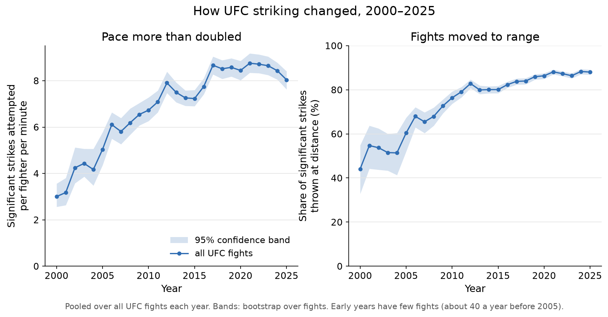
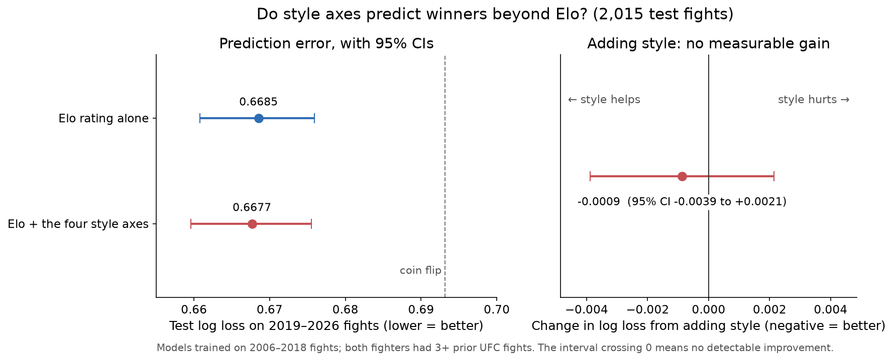

# UFC Fighter Styles

By [Bobby Bress](https://github.com/bbress467)

**[Explore the interactive style map →](https://bbress467.github.io/ufc-styles/)**

Describing UFC fighters' styles from round-by-round fight statistics, on continuous style axes with clusters as
a secondary shorthand, and testing whether style matchups predict outcomes beyond fighter skill.

**Status: complete.** The project includes a reproducible data pipeline, the style analysis (era-relative style axes and clusters),
the matchup analysis (an improved Elo and time-split tests) and the [live interactive site](https://bbress467.github.io/ufc-styles/).

**Built with** Python, pandas, scikit-learn, SQLite, matplotlib, D3 and GitHub Pages.

## About this project

I built this to test the fan idea that "styles make fights": that how two fighters match up stylistically decides fights as much as
who is better. Four clear, stable style dimensions describe how UFC fighters fight, but once skill is accounted for, style matchups
don't predict winners on fights the models never saw. The one small exception is that fighters who attempt more takedowns win
slightly more often.

## Results

Plain-language summary. Each finding links to the detail. Prediction claims are limited to what held up on fights from 2019 on,
which were never used to fit or tune anything.

### How fighters' styles differ: four style axes

Each fighter's style is described by four continuous scores ([docs/style_axes.md](docs/style_axes.md), `notebooks/05`–`06`). Each
fighter is compared with others in the same division whose careers fall within about four years of theirs, so the scores reflect style
rather than weight class or era.

| axis | name | a high score means |
|---|---|---|
| 1 | **grappler vs. volume striker** | more takedowns, control time and ground striking, and a lower striking pace |
| 2 | **clinch and body work** | more strikes thrown in the clinch and to the body |
| 3 | **submission hunting** | more submission attempts |
| 4 | **leg kicking** | more strikes aimed at the legs |


<!-- data-range:start -->*Based on UFC fights from 2000 through August 8, 2026.*<!-- data-range:end -->

**Reading the style map.** The map plots the first two axes. Left to right is axis 1, from more striking volume to more takedowns and
control; bottom to top is axis 2, from head strikes at range to clinch and body work. The chart splits at the average fighter (the
diamond in the centre), giving four broad styles:

- **Range strikers** (bottom left), e.g. Sean Strickland and Israel Adesanya
- **Clinch and body strikers** (top left), e.g. Nate Diaz and Anderson Silva
- **Clinch grapplers** (top right), e.g. Demetrious Johnson and Kamaru Usman
- **Wrestlers and ground grapplers** (bottom right), e.g. Khabib Nurmagomedov and Demian Maia

The shading darkens toward each outer corner, where the clearest examples of each style sit. These quadrant names describe regions of a
continuum, not separate groups: fighters near the centre have no strong lean either way, and positions are relative to fighters in the
same division and era. Axes 3 (submission hunting) and 4 (leg kicking) aren't shown here.

- **Together they capture about 77%** of the variation in the eight style measures.
- **They are very stable:** refitting on resampled fighters reproduces every axis almost exactly, with congruence 0.98 or higher.
- **The extremes are recognizable fighters:**
  - Khabib Nurmagomedov at the grappler end of axis 1, Max Holloway near the striker end
  - Loma Lookboonmee on axis 2
  - Charles Oliveira on axis 3
  - Chris Gutierrez on axis 4
- **Clusters are only a rough shorthand.** Three overlapping groups ([docs/clustering.md](docs/clustering.md)) are the best-supported
  clustering, but they're only moderately reproducible, so fighters are better described by their axis scores.

### How the sport has changed since 2000

From `notebooks/04_style_evolution.ipynb`, comparing 2000–04 with 2021–25, pooled over all UFC fights:



- **Pace more than doubled,** from about 3.8 to 8.5 significant-strike attempts per fighter-minute. Most of that rise came by about 2017.
- **Fights moved to range.** The share of significant strikes thrown at distance rose from about 52% to 88%. Clinch and ground
  striking each fell to about 6% of attempts, from about 20% and 29%.
- **Less control, fewer submission attempts.** Control time fell from about a third to about a fifth of fight time, and submission
  attempts per 15 minutes fell by about 60%.
- **Takedown attempts barely changed** (−13%), and the head still takes about three quarters of significant strikes.
- The same trends appear within the five men's divisions present throughout, so they aren't an artefact of new divisions. Some of the
  earliest change may reflect how older fights were recorded.

### Do style matchups predict who wins? Mostly no

([docs/matchups.md](docs/matchups.md), `notebooks/07_matchups.ipynb`.) Models were trained on 2006–18 fights and tested on about
2,000 fights from 2019 to 2026, with each fighter's style measured only from their earlier fights.



- **A better skill rating helps a lot.** The improved Elo, with newcomers rated against the current roster, bigger updates for finishes
  and K shrinking with experience, was tuned only on 2005–18 fights. On 2019+ fights the Elo favourite wins 58.0% of the time, against
  55.6% for the baseline Elo.
- **Style axes add nothing measurable on top of Elo.** Adding the fighters' differences on the four axes didn't improve predictions on
  2019+ fights (change in log loss −0.0009, 95% CI −0.0039 to +0.0021). With 5+ prior fights per fighter it was slightly worse. This null
  result holds with both the baseline and the improved Elo.
- **No matchup effect holds up.** Allowing specific style pairings to matter, such as "grapplers do better against leg kickers", overfit
  the training data and made 2019+ predictions worse unless shrunk to zero. A couple of pairings look significant in one period only,
  which is what chance produces across ten tests.
- **One pre-specified follow-up passed, modestly.** The only follow-up test asked whether *takedown attempts* alone add to the improved
  Elo. This measure has no control time or ground strikes, which can reflect who is winning. It did help: 2019+ log loss changed by
  −0.0027 (95% CI −0.0046 to −0.0008).
  - **Size:** a fighter one standard deviation ahead of their opponent in takedown attempts, for their division and era, wins about
    51.7% of otherwise even fights.
  - **Caveat:** the hypothesis was chosen after an earlier look at the same 2019+ fights had hinted at a grappling effect, and the
    effect isn't significant in the 2006–18 data alone. It should be confirmed on fights after August 2026 before being relied on.
  - It's a small edge for fighters who try to wrestle, not evidence that any style beats another.
- **Corner assignment** carries information (red wins about 57% of 2019+ fights), but the models deliberately ignore it, so predictions
  don't depend on which fighter is listed first.

## Pipeline

The data comes from a public, CC0 Kaggle dataset scraped from ufcstats.com
([neelagiriaditya/ufc-datasets-1994-2025](https://www.kaggle.com/datasets/neelagiriaditya/ufc-datasets-1994-2025)).
ufcstats.com itself is not scraped. A second public scrape,
[Greco1899/scrape_ufc_stats](https://github.com/Greco1899/scrape_ufc_stats), is used only as a UFC-event whitelist and for cross-checking.
See [docs/data_sources.md](docs/data_sources.md) for why this source was chosen.

| Step | Script | Output (gitignored) |
|---|---|---|
| 1. Download the pinned dataset versions (`data_versions.json`) | `src/download_data.py` | `data/raw/`, plus `data/raw/manifest.json` with checksums |
| 2. Keep UFC events, convert missing values, write tidy tables | `src/clean.py` | `data/processed/ufc.sqlite` |
| 3. Validate and write the data quality report | `src/validate.py` | [docs/data_quality.md](docs/data_quality.md) (committed) |
| 4. Build per-fighter style profiles (shrunk, standardized within division and era) | `src/features.py` | `data/processed/fighter_profiles.csv` |
| 5. Fit the style axes (PCA + varimax, 4 axes): the main style description | `src/style_axes.py` | `data/processed/style_axes.csv`, `data/processed/models/` |
| 6. Fit style clusters (PCA + Gaussian mixture): secondary shorthand | `src/clustering.py` | `data/processed/cluster_probabilities.csv`, `data/processed/models/` |
| 7. Elo ratings (all UFC fights since 1994; baseline and improved Elo, both tuned on 2005–18) | `src/elo.py` | `data/processed/elo_ratings.csv` (tuning table: [docs/elo_tuning.csv](docs/elo_tuning.csv), via `--tune`) |
| 8. Matchup models: Elo vs Elo + style, time split at 2019-01-01 | `src/matchups.py` | `data/processed/matchup_dataset.pkl` |
| 9. README figures and the site's link-preview image | `src/make_figures.py` | [docs/figures/](docs/figures/), [site/og-image.png](site/og-image.png) (committed) |
| 10. Data for the interactive style map | `src/export_site_data.py` | [site/data/fighters.json](site/data/fighters.json) (committed) |

Feature definitions and decisions: [docs/feature_spec.md](docs/feature_spec.md). Style axes: [docs/style_axes.md](docs/style_axes.md).
Clustering: [docs/clustering.md](docs/clustering.md). Matchup analysis, Elo and evaluation design: [docs/matchups.md](docs/matchups.md).
Site structure notes: [docs/site_map.md](docs/site_map.md).

## How to run

```bash
python -m venv venv
venv/bin/pip install -r requirements.txt
venv/bin/python src/download_data.py
venv/bin/python src/clean.py
venv/bin/python src/validate.py
venv/bin/python src/features.py
venv/bin/python src/style_axes.py
venv/bin/python src/clustering.py
venv/bin/python src/elo.py
venv/bin/python src/matchups.py
venv/bin/python src/make_figures.py
venv/bin/python src/export_site_data.py
venv/bin/python -m unittest discover tests
```

`src/download_data.py --latest` moves the pins to the newest dataset versions. No Kaggle login is needed.
`src/elo.py` writes ratings with the chosen settings (`elo.ELO_PARAMS`) in about a second. `src/elo.py --tune` reruns the settings
grid search on 2005–18 fights (about 40 minutes) and rewrites [docs/elo_tuning.csv](docs/elo_tuning.csv), the committed table of
the best setting per variant. It doesn't change `ELO_PARAMS`; update that by hand if the best setting changes.
Notebooks:

- `01_feature_eda`: feature distributions, correlations, shrinkage priors
- `02_pca`: PCA of the style features
- `03_clustering`: choosing k, cluster profiles, confounding checks
- `04_style_evolution`: unadjusted style features by year since 2000
- `05_style_axes`: choosing 3 vs 4 axes, loadings, fighters at each end
- `06_style_map`: fighters plotted on the axes
- `07_matchups`: Elo variants, model comparison, calibration, style coefficients, the pre-specified takedown test, interpretation

## Interactive style map

[`site/`](site/) holds an interactive version of the style map. Hover over a fighter for a quick look; click or tap one, or search
by name, to open their card: division, UFC fights since 2000, career years, quadrant, their scores on all four style axes (relative
to their division and era) and the five fighters with the most similar scores across all four axes. While a card is open the page
address ends in the fighter's ufcstats ID (for example `#427b5953ac8e3a27`), so the link opens straight to that fighter. It's a static page (HTML, CSS and JavaScript, with D3 7.9.0 from a CDN) that
reads `site/data/fighters.json`, written by `src/export_site_data.py`.

**Open it on your computer.** The page loads its data with `fetch`, which browsers block for files opened directly from disk, so serve
the folder with Python's built-in web server:

```bash
python3 -m http.server 8000 --directory site
```

Then open <http://localhost:8000> in a browser. Stop the server with Ctrl+C.

**Publishing.** [`.github/workflows/pages.yml`](.github/workflows/pages.yml) deploys `site/` to GitHub Pages on every push to `main`
(or by hand from the Actions tab). Once Pages is turned on (Settings → Pages → Source: GitHub Actions), the site is at
<https://bbress467.github.io/ufc-styles/>.

## Date cutoff

The analysis uses **UFC fights from 2000 onward**. Control time isn't recorded before 1999 and is incomplete in 1999
(see the completeness-by-year table in [docs/data_quality.md](docs/data_quality.md)). Starting in 2000 also excludes the early era,
when the rules and weight classes differed from the modern sport.
